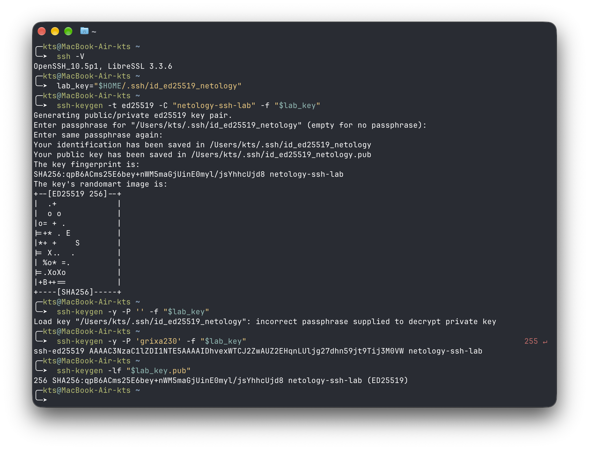
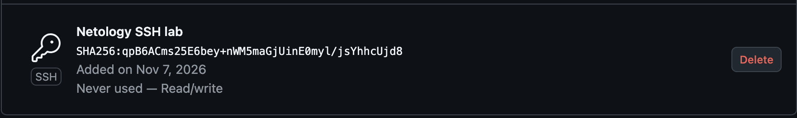
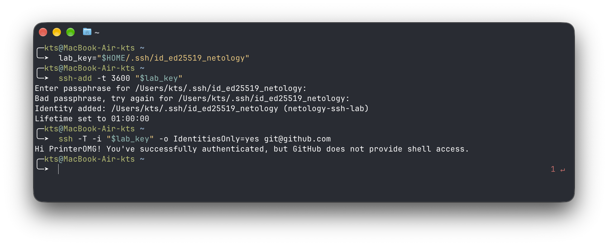
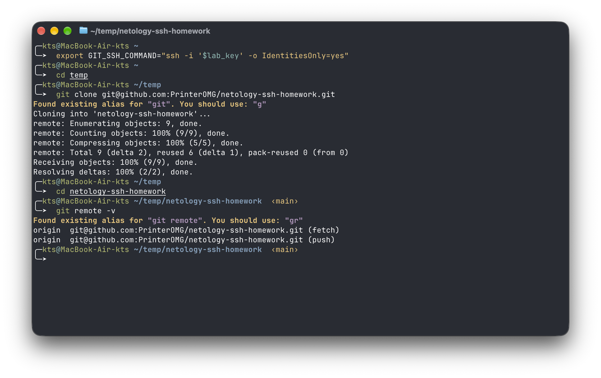
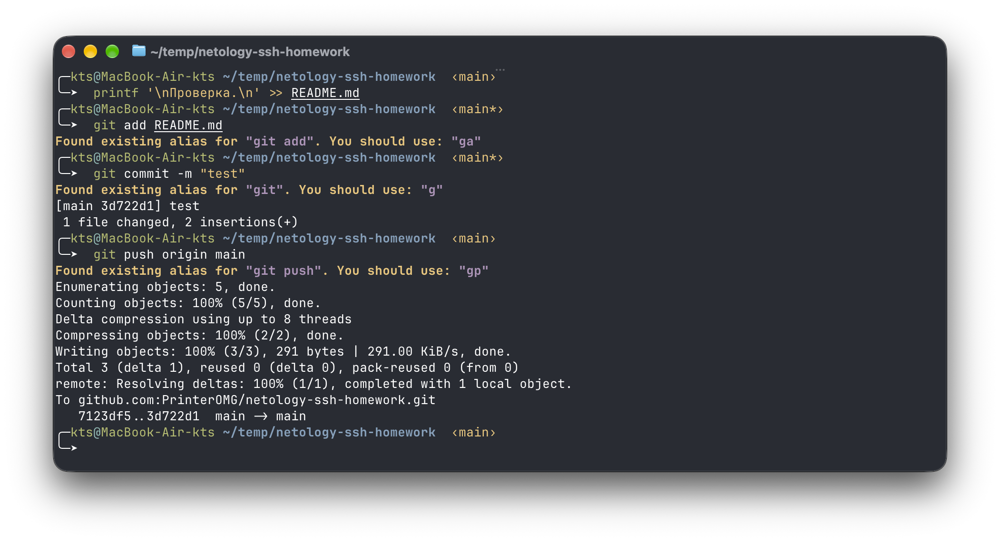

# Работа с серверами и протокол удалённого управления SSH

Домашнее задание 3 по дисциплине "Программная инженерия 1"
Китаев Григорий Алексеевич

## Ход работы

### 1. SSH-клиент и ключевая пара

На macOS проверил версию OpenSSH и сгенерировал ключ Ed25519 с парольной фразой.

```console
$ ssh -V
OpenSSH_10.5p1, LibreSSL 3.3.6
$ lab_key="$HOME/.ssh/id_ed25519_netology"
$ ssh-keygen -t ed25519 -C "netology-ssh-lab" -f "$lab_key"
```

Публичная часть сохранилась в `~/.ssh/id_ed25519_netology.pub`. Проверил, что пустая фраза не позволяет расшифровать приватный ключ, и вывел отпечаток публичного ключа.

```console
$ ssh-keygen -y -P '' -f "$lab_key"
Load key "/Users/kts/.ssh/id_ed25519_netology": incorrect passphrase supplied to decrypt private key
$ ssh-keygen -lf "$lab_key.pub"
256 SHA256:qpB6ACms25E6bey+nWM5maGjUinE0myl/jsYhhcUjd8 netology-ssh-lab (ED25519)
```



Знаю, что парольная фраза попала на скриншот. Учебный ключ уже удалён, всё под контролем)

### 2. Добавление публичного ключа в GitHub

В настройках GitHub открыл SSH and GPG keys -> New SSH key, указал название `Netology SSH lab` и добавил ключ с типом Authentication Key. Отпечаток в GitHub совпал с отпечатком в терминале.



### 3. Проверка SSH-подключения

Добавил учебный ключ в `ssh-agent` на один час и проверил вход по SSH.

```bash
ssh-add -t 3600 "$lab_key"
ssh -T -i "$lab_key" -o IdentitiesOnly=yes git@github.com
```

GitHub подтвердил аутентификацию под моим аккаунтом `PrinterOMG`



### 4. Клонирование и отправка коммита по SSH

У меня уже были SSH-ключи для GitHub, поэтому задал переменную `GIT_SSH_COMMAND`, чтобы Git использовал именно учебный ключ. Затем клонировал репозиторий и проверил адрес `origin` для получения и отправки изменений.

```bash
export GIT_SSH_COMMAND="ssh -i '$lab_key' -o IdentitiesOnly=yes"
git clone git@github.com:PrinterOMG/netology-ssh-homework.git
cd netology-ssh-homework
git remote -v
```



Добавил в README тестовую строку, закомитил и запушил его в `main` - GitHub принял коммит по SSH без запроса пароля.

```bash
printf '\nПроверка.\n' >> README.md
git add README.md
git commit -m "test"
git push origin main
```


